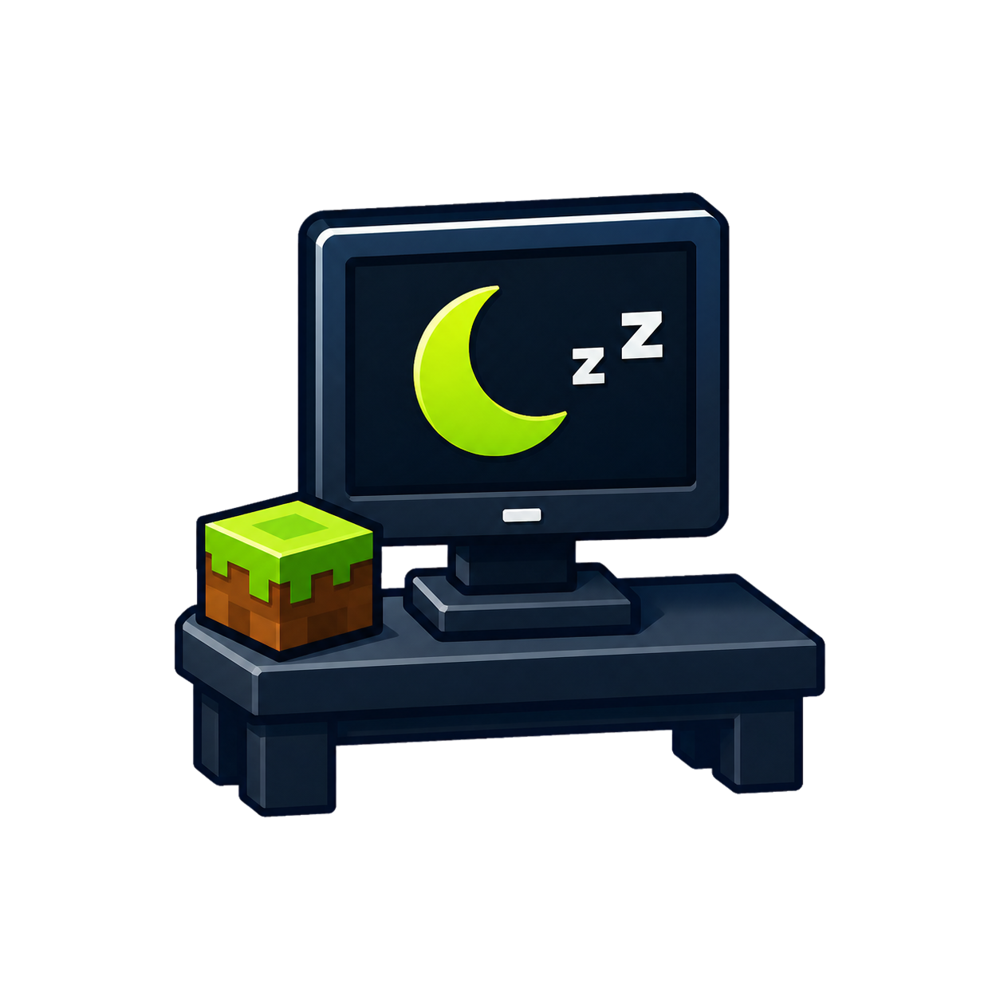
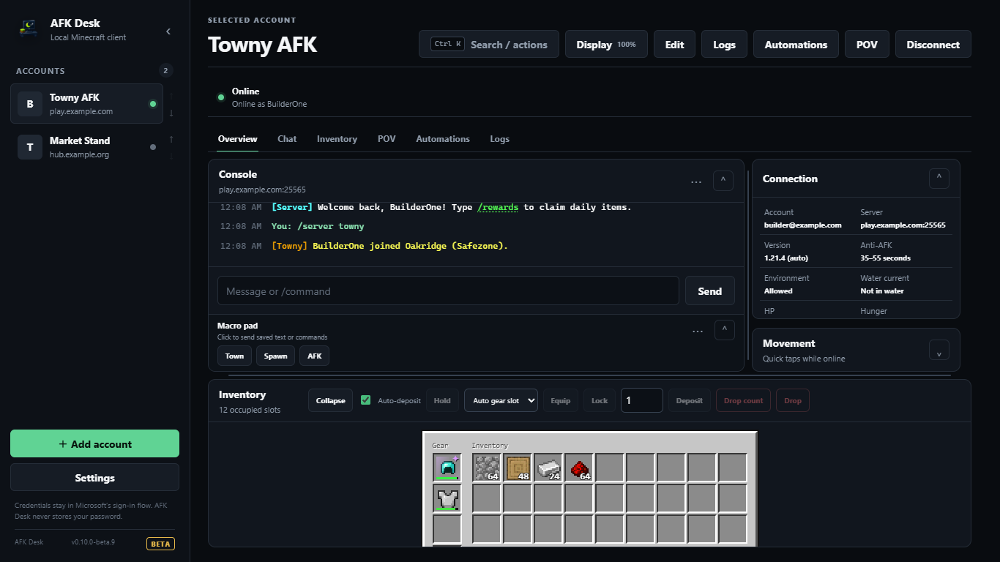
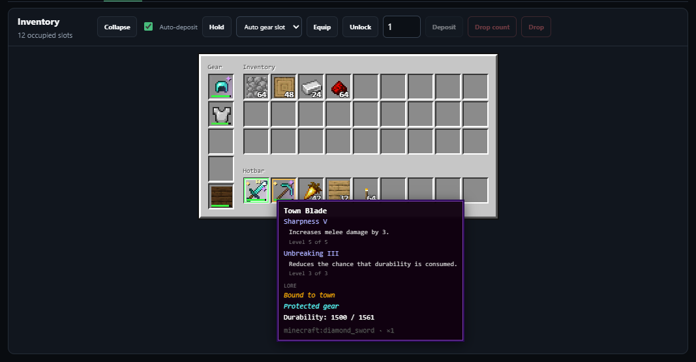
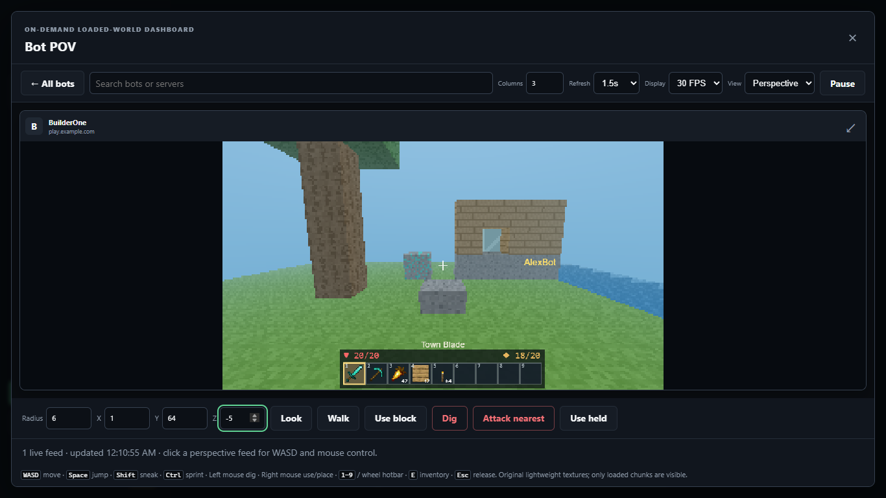

<p align="center">
  
</p>

<h1 align="center">AFK Desk</h1>

<p align="center">
  A free, local-first Minecraft AFK client for Windows and Android — keep your own accounts online, manage inventory and auto-deposit, and run anti-AFK actions without running the full game.
</p>

<p align="center">
  <a href="https://github.com/legendary-cookie/afk-desk/releases/latest"></a>
  <a href="https://github.com/legendary-cookie/afk-desk/actions/workflows/ci.yml"></a>
  <a href="LICENSE"></a>
</p>

<p align="center">
  <a href="#downloads">Downloads</a> · <a href="docs/user-guide/index.md">User Guide</a> · <a href="#quick-start">Quick Start</a> · <a href="#supported-versions">Supported Versions</a> · <a href="HISTORY.md">Version History</a>
</p>



## Downloads

| Platform / Channel | Version | Download | Notes |
| --- | --- | --- | --- |
| **Windows (Recommended Beta)** | `0.11.0-beta.1` | [AFK-Desk-Setup-0.11.0-beta.1.exe](https://github.com/legendary-cookie/afk-desk/releases/download/v0.11.0-beta.1/AFK-Desk-Setup-0.11.0-beta.1.exe) · [Release page](https://github.com/legendary-cookie/afk-desk/releases/tag/v0.11.0-beta.1) | Recommended. Macro engine v2 with templates, Discord/Telegram notifications, Discord bot control, Bedrock support, and remote access settings. |
| **Android (Recommended Beta)** | `0.11.0-beta.1` | [AFK-Desk-Android-0.11.0-beta.1.apk](https://github.com/legendary-cookie/afk-desk/releases/download/v0.11.0-beta.1/AFK-Desk-Android-0.11.0-beta.1.apk) · [Release page](https://github.com/legendary-cookie/afk-desk/releases/tag/v0.11.0-beta.1) | Recommended. Installs over 0.9.2 and keeps your data (same signing key). Android 7.0+. |
| **Windows (Previous Stable)** | `0.9.2` | [AFK-Desk-Setup-0.9.2.exe](https://github.com/legendary-cookie/afk-desk/releases/download/v0.9.2/AFK-Desk-Setup-0.9.2.exe) · [Release page](https://github.com/legendary-cookie/afk-desk/releases/tag/v0.9.2) | Previous stable Windows installer. |
| **Android (Previous Stable)** | `0.9.2` | [AFK-Desk-Android-0.9.2.apk](https://github.com/legendary-cookie/afk-desk/releases/download/v0.9.2/AFK-Desk-Android-0.9.2.apk) · [Release page](https://github.com/legendary-cookie/afk-desk/releases/tag/v0.9.2) | Previous stable on-device client (Android 7.0+). |
| **iOS (Source)** | `0.1.0` | [Build instructions](mobile/BUILDING.md) | Shared React Native Xcode project; requires macOS, Xcode, and personal signing. |

All releases and source archives are listed on the [GitHub Releases page](https://github.com/legendary-cookie/afk-desk/releases). Artifact SHA-256 hashes are recorded in [RELEASE_CHECKSUMS.txt](RELEASE_CHECKSUMS.txt).

## Features

### Accounts
- **Multi-account & multi-profile**: Add unlimited Microsoft accounts and create multiple server profiles per account without subscriptions or account-count caps.
- **Device-code sign-in**: Authenticate via Microsoft's official OAuth device-code flow (`https://microsoft.com/link`) or an isolated in-app sign-in window with no shared browser cookies.
- **Automatic profile discovery**: Resolves each account's Minecraft username (IGN), UUID, and official player-head avatar automatically on login.
- **Per-account proxies**: Route Java Edition connections through `SOCKS5` or `HTTP CONNECT` proxies, or share proxies across profiles with the health-checked **Smart Proxy Pool** (Windows beta).
- **Staggered startup logins**: Optionally launch AFK Desk with Windows and stagger startup connections across accounts by a configurable delay.

### AFK & Automation
- **Customizable anti-AFK**: Combine Jump, Look around, Sneak, Swing arm, and bounded Short walk with randomized min/max intervals, action durations, and look angles.
- **Environmental movement**: Native Mineflayer physics stay enabled by default so water currents (AFK pools), knockback, explosions, and nearby entities move the bot naturally, with live water-current diagnostics.
- **Join & world-change messages**: Send separate automatic messages or `/server` commands on initial join and after world or proxy-server switches.
- **Chat, tab-completion & macro pad**: Scrolling color-formatted console, `Tab` completion for commands and player names, clickable chat actions, `↑`/`↓` history recall, and one-click chat shortcut buttons.

### Inventory
- **Visual inventory & gear grids**: Inspect equipped armor, off-hand gear, 27-slot storage, and 9-slot hotbar with vanilla item icons, stack counts, durability bars, enchantment glint, and rich hover tooltips.
- **Stack management**: Drag and drop to move or swap slots, select the active hotbar item, equip armor/off-hand items, or drop an entire stack or specific item count.
- **Item locks**: Lock important slots (weapons, tools, crate keys) so they cannot be dropped or auto-deposited.
- **Auto-deposit**: Continuously or manually transfer unlocked inventory stacks into the closest visible chest, trapped chest, or barrel within a `1`–`16` block line-of-sight range.



### POV & Menus
- **Lightweight Bot POV (Windows 0.10.0-beta.9 and later)**: On-demand perspective (3D voxel) and top-down map views of loaded chunks with HUD, `WASD` + mouse-look pointer lock, and coordinate actions (`Look`, `Walk`, `Use block`, `Dig`, `Attack nearest`, `Use held`). Rendering stops completely when the POV dialog is closed.
- **Interactive server menus**: Click slots in server chest GUIs (`/menu`, `/shop`, `/warp`) with full hover tooltips, downloaded server resource-pack item models, and bitmap-font GUI container backgrounds.



### Reliability
- **Exponential backoff auto-reconnect**: Reconnects after kicks, timeouts, or network drops with configurable initial delay, backoff multiplier, max delay, and rate-limit minimum wait.
- **Modern Velocity server transfers**: Quiesces gameplay packets while 1.20.2+ connections transition through the `configuration` state during proxy server switches.
- **Responsive layout**: Resizable console and inventory splitters, collapsible panels, interface scaling (`75%`–`125%`), and workspace themes.

### Privacy
- **100% local execution**: Credentials and tokens stay on your device inside the local application data folder. Microsoft passwords never enter AFK Desk.
- **Encrypted secrets**: Proxy passwords are encrypted at rest with Electron `safeStorage` (Windows Data Protection API).
- **Proxy IP leak protection**: When an account uses a proxy, AFK Desk skips direct HTTP resource-pack downloads by default (while still answering `accepted` so servers do not kick the bot).
- **Zero telemetry**: No analytics, remote control server, or third-party tracking.

## Supported Versions

- **Java Edition (Windows & Android)**: **28 complete bot versions from `1.8.8` through `1.21.11`**, with automatic server version detection and explicit version selection:
  `1.8.8`, `1.9.4`, `1.10.2`, `1.11.2`, `1.12.2`, `1.13.2`, `1.14.4`, `1.15.2`, `1.16.5`, `1.17.1`, `1.18.2`, `1.19`, `1.19.2`, `1.19.3`, `1.19.4`, `1.20`, `1.20.1`, `1.20.2`, `1.20.4`, `1.20.6`, `1.21.1`, `1.21.3`, `1.21.4`, `1.21.5`, `1.21.6`, `1.21.8`, `1.21.9`, `1.21.11`.
- **Modded & Proxy Servers**: Supports Vanilla, Paper/Spigot/Purpur, BungeeCord/Velocity, and lightweight brand/channel/legacy Forge FML1–FML3 handshakes. Client-side Java mod code is not executed. See [docs/COMPATIBILITY.md](docs/COMPATIBILITY.md) for exact boundaries.
- **Bedrock Edition (Windows 0.10.0-beta.9 and later)**: Supports Microsoft sign-in, connecting, chat/commands, auto-reconnect, and basic health/hunger/position telemetry over UDP/RakNet. Movement, inventory actions, POV blocks, and TCP proxies are not enabled for Bedrock.

## Quick Start

1. **Install**: Download and run the [Windows installer or Android APK](#downloads).
2. **Add an account**: Click **Add account**, enter a profile name, your Microsoft account email, and the server address (`host:port`), then click **Save account**.
3. **Connect**: Select the profile and click **Connect**.
4. **Sign in with Microsoft**: Copy the one-time device code shown in AFK Desk, click **Sign in with a different account** (or open `https://microsoft.com/link` in your browser), and approve access.
5. **Configure AFK behavior**: Use the console to chat, toggle **Auto-deposit** or lock inventory slots as needed, or click **Edit** to tune anti-AFK intervals, join commands, and auto-reconnect delays.

## User Guide

- [User Guide Overview](docs/user-guide/index.md)
- [Getting Started](docs/user-guide/getting-started.md) — Installation, first account setup, and Microsoft device-code sign-in
- [Accounts and Proxies](docs/user-guide/accounts-and-proxies.md) — Multi-account profiles, SOCKS5/HTTP proxies, smart proxy pool, and startup logins
- [Anti-AFK and Auto-Reconnect](docs/user-guide/anti-afk-and-reconnect.md) — Anti-AFK actions, water physics, automatic messages, and backoff settings
- [Inventory and Auto-Deposit](docs/user-guide/inventory-and-auto-deposit.md) — Gear/inventory grids, item locks, dropping stacks, and chest auto-deposit
- [POV View and Server Menus](docs/user-guide/pov-and-server-menus.md) — 3D/map POV controls, coordinate actions, and resource-pack server menus
- [Android App](docs/user-guide/android.md) — APK installation, foreground service & battery settings, and mobile boundaries
- [Macros (available in 0.11 (pre-release))](docs/user-guide/macros.md) — Declarative trigger-to-steps macro engine v2 preview and example macros
- [Notifications (available in 0.11 (pre-release))](docs/user-guide/notifications.md) — Outbound Discord webhook and Telegram bot alert setup and privacy
- [Self-Hosting & Server Mode](docs/user-guide/self-hosting.md) — Headless server operation, Docker quick start, admin setup, device-code sign-in, and backup/restore
- [Remote Access via Tailscale](docs/user-guide/remote-access-tailscale.md) — Secure private access via Tailscale, desktop remote settings, sidecar compose, and MagicDNS
- [Reverse Proxy Setup](docs/user-guide/reverse-proxy.md) — Caddy auto-HTTPS and Nginx reverse proxy configurations, trustProxy, and security warnings
- [API Tokens & Automation](docs/user-guide/api-tokens.md) — REST API and WebSocket tokens, permission scopes (read/control/admin), and curl examples
- [Discord Bot Control](docs/user-guide/discord-bot.md) — Slash commands (/afk), bot creation, guild authorizations, interactive confirmations, and ephemeral replies
- [Bedrock Edition](docs/user-guide/bedrock.md) — Bedrock Edition support, current feature matrix (Phases 1–2), telemetry, forms, and stationary anti-AFK
- [Security Model](docs/user-guide/security.md) — Threat model, CSRF/Origin/Host defences, scrypt hashing, rate limits, and audit logs
- [Troubleshooting](docs/user-guide/troubleshooting.md) — Connection errors, version mismatches, sign-in tips, proxy resource packs, and storage warnings
- [FAQ](docs/user-guide/faq.md) — Common questions on security, server rules, performance, and local files

## FAQ Highlights

- **Does AFK Desk store my Microsoft password?** No. Sign-in uses Microsoft's official device-code flow; only local auth tokens are cached in your user-data folder.
- **Does AFK Desk bypass captchas or anti-bot systems?** No. AFK Desk does not bypass captchas, anti-bot checks, or server bans. Always follow each server's rules.
- **Why was a server resource pack skipped when using a proxy?** Resource-pack HTTP downloads cannot be routed through a SOCKS5/HTTP game proxy. AFK Desk skips the direct download by default so your real IP is not revealed, while still sending `accepted` so the server does not kick you.
- **Does the POV view use CPU in the background?** No. World snapshots and voxel rendering run only while the **Bot POV** dialog is open.

See the full [FAQ](docs/user-guide/faq.md) and [Troubleshooting guide](docs/user-guide/troubleshooting.md) for more answers.

## Building from Source

### Desktop (`desktop/`)

Requires **Node.js 22** or newer.

```powershell
cd desktop
npm ci
npm ci --prefix ../mobile/nodejs-assets/nodejs-project
npm test
npm start
```

To build the Windows installer into `desktop/dist/`:

```powershell
cd desktop
npm run dist
```

See [desktop/README.md](desktop/README.md) for desktop development notes.

### Mobile (`mobile/`)

The Android client uses React Native with an embedded Node.js + Mineflayer project in `mobile/nodejs-assets/nodejs-project`. Building the release APK requires JDK 17, Android SDK Platform 35, NDK 26.1.10909125, and CMake 3.22.1.

See [mobile/README.md](mobile/README.md) and [mobile/BUILDING.md](mobile/BUILDING.md) for complete Android and iOS build and signing instructions.

## Project Status & Roadmap

- **Released — `0.9.2` (Stable Windows & Android)**: Complete 28-version Java matrix (`1.8.8`–`1.21.11`), directional water physics, modern configuration-phase proxy transfer guards, resource-pack server menus, item locks, and auto-deposit.
- **Released — `0.10.0-beta.9` (Windows Pre-release)**: Lightweight on-demand 3D/map POV view, workspace themes, smart proxy pool, experimental Bedrock Edition support, persistent event logs, and initial automations UI.
- **Released — `0.11.0-beta.1` (Recommended, Windows & Android)**: Macro engine v2 with templates, Discord/Telegram notifications, Discord bot control, Bedrock phase 1, and remote access settings.
- **In Development — `0.11.0` Stable**: Ongoing reliability, storage safety, and regression hardening across desktop and mobile engines.
- **Coming in `0.11` (In Development)**:
  - **Macro Engine v2** ([design doc](docs/design/macro-engine.md) · [user guide preview](docs/user-guide/macros.md)): Shared macro library with account/tag targets, edge-triggered events (`join`, `worldChange`, `timer`, `schedule`, `chat` globs, `healthBelow`, `inventoryFull`, `windowOpen`), cooperative cancellation, rate budgets, and strict item-lock enforcement.
  - **Outbound Discord & Telegram Notifications** ([contract](desktop/electron/notify/contract.cjs) · [user guide preview](docs/user-guide/notifications.md)): Encrypted, rate-limited, outbound-only Discord webhook and Telegram bot alerts for disconnects, kicks, bans, deaths, low health, full inventory, and macro events.

See [CHANGELOG.md](CHANGELOG.md) and [HISTORY.md](HISTORY.md) for detailed release history.

## Responsible Use, Contributing, Security & License

- **Responsible use**: Use AFK Desk only with accounts and servers you are authorized to access. Server rules may prohibit AFK clients, automation, multiple accounts, or proxies. AFK Desk does not bypass Microsoft authentication, captchas, anti-bot systems, server permissions, or bans.
- **Contributing**: Bug reports and focused pull requests are welcome. Read [CONTRIBUTING.md](CONTRIBUTING.md) before opening a pull request.
- **Security**: Please do not post tokens, credentials, or private server details in public issues. See [SECURITY.md](SECURITY.md) and [desktop/SECURITY.md](desktop/SECURITY.md) for vulnerability reporting and security boundaries.
- **License**: Released under the [MIT License](LICENSE).

AFK Desk is an independent open-source project and is not affiliated with Mojang, Microsoft, Minecraft, Valoks, or AFK Console Client.
