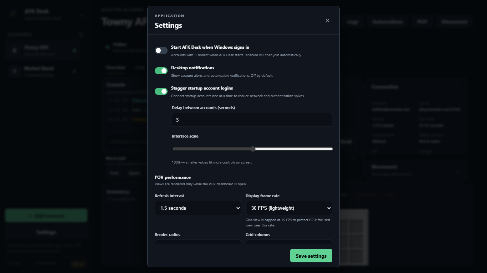

# Accounts and Proxies

AFK Desk lets you run multiple Microsoft-authenticated Minecraft accounts and multiple server profiles per account, each with its own proxy and startup settings.

## Managing multiple accounts and profiles

- **Add another Microsoft account**: Click **Add account**, enter the new Microsoft account email and server details, and click **Connect**. When the device-code prompt appears, use **Sign in with a different account** so the login window starts with a clean, isolated cookie session.
- **Multiple profiles for one account**: One Microsoft identity can have several server profiles (for example, `Survival Server` and `Skyblock Hub`). Click **Edit** on an existing profile and click **Duplicate profile** to create a second server profile that shares the same authenticated Microsoft token cache.
- **Ordering accounts**: Drag and drop accounts in the left sidebar, or use the **↑** and **↓** buttons next to each account row. Account order is saved automatically.

## Configuring per-account proxies (Java Edition)

Each Java Edition profile can connect directly or route its Minecraft TCP connection through a proxy. Microsoft authentication remains direct so sign-in tokens are not exposed to third-party proxy hosts.

1. Select an account and click **Edit**.
2. Scroll to the **Proxy** section and set **Proxy assignment**:
   - **Direct connection**: Connects directly without a proxy.
   - **Manual proxy below**: Uses the proxy configured on this profile.
   - **Smart proxy pool**: Automatically leases a healthy proxy shared by your other profiles.
3. For a manual proxy, enable **Use a proxy for this account** and configure:
   - **Proxy type**: `SOCKS5` (default port `1080`) or `HTTP CONNECT` (default port `8080`).
   - **Proxy host** and **Proxy port**.
   - **Username** and **Password** (optional): When saved, the proxy password is encrypted on disk using Electron `safeStorage` (backed by Windows Data Protection API) and is never read back into the UI.
4. Click **Save account**.

### Using the Smart Proxy Pool

If you have several proxies and want AFK Desk to distribute sessions and avoid failing endpoints:

1. On each profile that defines a proxy, check **Share this manual proxy with the smart pool**, give it a **Pool label**, and set **Maximum sessions** (for example `1` or `2`).
2. On other profiles, set **Proxy assignment** to **Smart proxy pool**.
3. When connecting, AFK Desk selects an available shared proxy below its session limit, keeps sticky assignment per Microsoft identity when possible, and places failing proxies on cooldown.

> **Bedrock note:** Bedrock Edition uses UDP/RakNet (`19132`) and only supports direct connections; the Java TCP proxy settings are disabled for Bedrock profiles.

## Startup connections

You can connect accounts automatically when AFK Desk opens or when Windows signs in:

1. In the account editor (**Edit**), enable **Connect when AFK Desk starts** and click **Save account**.
2. Open **Settings** from the left sidebar to configure global startup behavior:
   - **Start AFK Desk when Windows signs in**: Launches AFK Desk automatically at Windows login.
   - **Stagger startup account logins**: Enabled by default. Connects startup accounts one at a time using **Delay between accounts (seconds)** (default `3` seconds) to avoid network and authentication spikes.

## Modded server compatibility

AFK Desk is a protocol client, not a full Minecraft JVM. In the account editor, expand **Modded server compatibility** to configure client brand, Forge FML1/FML2/FML3 handshakes, manual mod lists, or custom plugin channels. See [Lightweight Client Compatibility](../COMPATIBILITY.md) for exact protocol boundaries across Vanilla, Paper/Velocity, Fabric, Quilt, Forge, NeoForge, and Sponge.

---

**Next:** [Anti-AFK and Auto-Reconnect →](anti-afk-and-reconnect.md)
