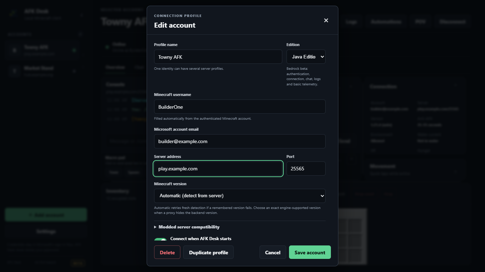

# Getting Started

This guide walks through installing AFK Desk, adding your first Minecraft profile, completing Microsoft device-code sign-in, and connecting to a server.

## 1. Install AFK Desk

Download the release for your platform from the [GitHub Releases page](https://github.com/legendary-cookie/afk-desk/releases):

- **Windows (Stable)**: Download `AFK-Desk-Setup-0.9.2.exe` from the [v0.9.2 release](https://github.com/legendary-cookie/afk-desk/releases/tag/v0.9.2).
- **Windows (Pre-release Beta)**: Download `AFK-Desk-Setup-0.10.0-beta.9.exe` from the [v0.10.0-beta.9 pre-release](https://github.com/legendary-cookie/afk-desk/releases/tag/v0.10.0-beta.9) for the lightweight POV view, workspace themes, and beta automation UI.
- **Android**: Download `AFK-Desk-Android-0.9.2.apk` from the [v0.9.2 release](https://github.com/legendary-cookie/afk-desk/releases/tag/v0.9.2) (see the [Android guide](android.md)).

> **Note on Windows SmartScreen:** Release installers are currently unsigned. If Windows SmartScreen prompts you, verify the installer SHA-256 against [`RELEASE_CHECKSUMS.txt`](../../RELEASE_CHECKSUMS.txt) or the release notes before choosing **More info → Run anyway**.

## 2. Add your first account profile

1. Launch AFK Desk and click **Add account** in the left sidebar (or **Add your first account** on the welcome screen).
2. Fill in the connection profile fields:
   - **Profile name**: A friendly label such as `Towny AFK`.
   - **Edition**: Keep **Java Edition** selected (or choose **Bedrock Edition (experimental)** for basic Bedrock connections).
   - **Microsoft account email**: The email address for your Microsoft account. This is used to organize local token caches.
   - **Server address** and **Port**: The server hostname (for example `play.example.com`) and port (default `25565` for Java, `19132` for Bedrock).
   - **Minecraft version**: Leave set to **Automatic (detect from server)** or pick an exact version from `1.8.8` through `1.21.11`.
3. Click **Save account**.

## 3. Connect and complete Microsoft sign-in

1. Select your profile in the sidebar and click **Connect** in the top bar.
2. On your first connection for that Microsoft identity, AFK Desk opens the **Microsoft sign-in** dialog with a one-time device code:
   - Click the code button to copy the one-time code.
   - Click **Sign in with a different account** to open an isolated in-app Microsoft sign-in window (recommended when managing multiple Microsoft accounts, as it does not share cookies with your default browser), or click **Use my default browser** to open `https://microsoft.com/link`.
   - Enter the code on Microsoft's page and sign in.
3. Once approved, Prismarine Auth caches the token locally in your AFK Desk user-data directory. Subsequent connections reuse the cached token automatically without asking for a code.

> **Privacy note:** Your Microsoft password never enters AFK Desk. Authentication happens directly with Microsoft via device-code flow.

## 4. Verify your connection

When the account spawns in the world:

- The status banner changes to **Online**, and your Minecraft username (IGN) and player-head avatar are filled in automatically.
- Live server chat appears in the **Console** panel, where you can send messages, use `Tab` for command and player-name completion, or recall history with `↑`/`↓`.
- The **Connection** and **Inventory** panels show live HP, hunger, coordinates, dimension, water-current status, and items.

---

**Next:** [Accounts and Proxies →](accounts-and-proxies.md)
