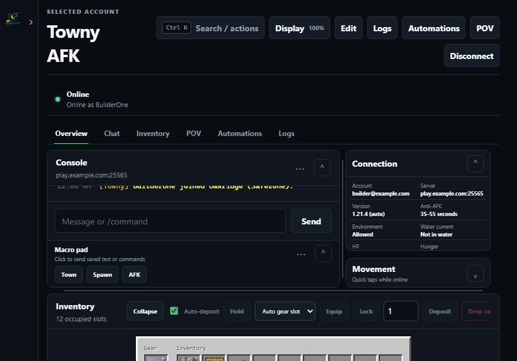

# AFK Desk User Guide

AFK Desk is a local-first Minecraft AFK client for Windows desktop and Android. It keeps your own Minecraft accounts online, runs chat commands and anti-AFK actions, manages inventory and auto-deposit, and provides an on-demand lightweight POV view without running the full game client.

## Contents

1. [Getting Started](getting-started.md) — Install AFK Desk, add your first account, sign in with a Microsoft device code, and connect.
2. [Accounts and Proxies](accounts-and-proxies.md) — Manage multiple Microsoft accounts, server profiles, SOCKS5/HTTP proxies, smart proxy pools, and startup connections.
3. [Anti-AFK and Auto-Reconnect](anti-afk-and-reconnect.md) — Configure randomized anti-AFK actions, environmental movement, automatic join/world-change messages, and exponential backoff reconnects.
4. [Inventory and Auto-Deposit](inventory-and-auto-deposit.md) — Inspect gear and inventory, lock important slots, drop or equip items, and auto-deposit into nearby chests or barrels.
5. [POV View and Server Menus](pov-and-server-menus.md) — Use the on-demand 3D/map POV dashboard, run world actions, and click custom server menus with resource-pack artwork.
6. [Android App](android.md) — Install the standalone Android APK, configure foreground service and battery settings, and review mobile boundaries.
7. [Macros (Coming in 0.11 / In Development)](macros.md) — Preview the declarative trigger-to-steps macro engine v2 and example workflows.
8. [Notifications (Coming in 0.11 / In Development)](notifications.md) — Preview outbound Discord webhook and Telegram bot alerts, setup steps, and privacy guarantees.
9. [Troubleshooting](troubleshooting.md) — Fix connection errors, version mismatches, Microsoft sign-in issues, skipped resource packs behind proxies, and storage warnings.
10. [FAQ](faq.md) — Answers to common questions about security, server rules, supported versions, and resource usage.

## Interface tips

- **Command Center (`Ctrl+K`)**: Search and run actions, switch accounts, or change workspace layouts from anywhere in the desktop app.
- **Display & Themes**: Click **Display** in the top bar (or open **Settings**) to adjust interface scaling (`75%`–`125%`), workspace density, and color themes.
- **Compact Layout**: Collapse the accounts sidebar (`‹`), console sections, or inventory panel, and drag the panel splitters to fit narrow or tiled windows.

---

**Next:** [Getting Started →](getting-started.md)
