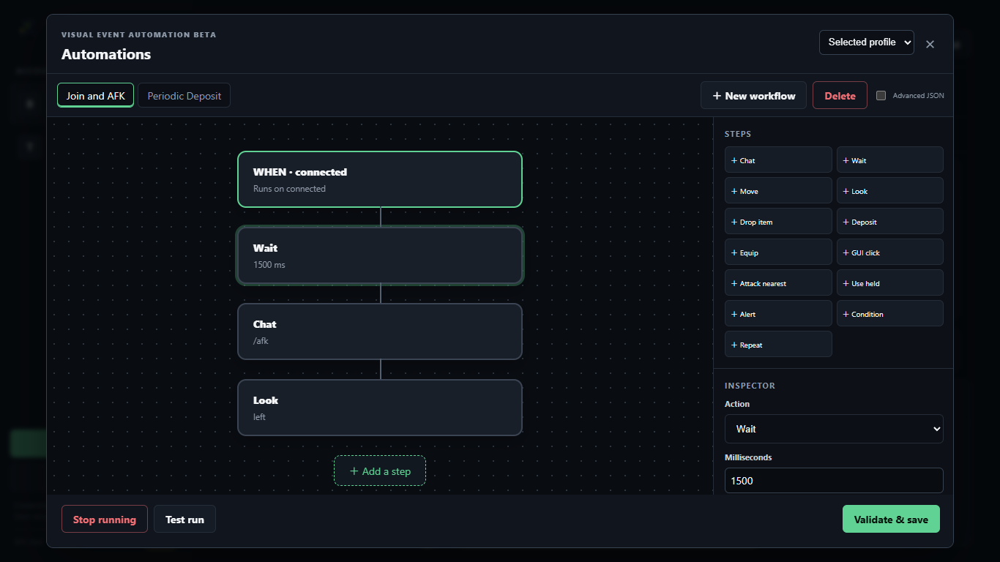

# Macros (Coming in 0.11 / In Development)

> **Status: Coming in 0.11 / In development.**
> Windows `0.10.0-beta.9` includes an early per-account **Automations (beta)** dialog for basic workflows. The declarative **Macro Engine v2** described on this page is currently in development on the `feature/macro-engine` branch (see [`docs/design/macro-engine.md`](https://github.com/legendary-cookie/afk-desk/blob/feature/macro-engine/docs/design/macro-engine.md)) and is not yet in a published release.



## Overview of Macro Engine v2

Macro Engine v2 upgrades AFK Desk's beta automations into a shared **macro library** where each workflow connects a **trigger** to an ordered list of **steps**, with optional conditions, loops, and stop rules:

- **One library, flexible targets**: Instead of copying the same workflow across 20 profiles, each macro can target **All accounts**, **Selected accounts**, or account **Tags**. Existing v1 per-account automations from `0.10.0-beta.9` migrate automatically on upgrade.
- **Declarative and local**: Macros use safe, built-in actions — never arbitrary JavaScript `eval` or shell commands — and respect per-account rate budgets (up to 20 steps/sec and configurable chat rate limits) so accounts are not kicked for spam.
- **Respects item locks**: Drop, deposit, equip, and GUI click steps strictly enforce your [item locks](inventory-and-auto-deposit.md#item-locks-protecting-gear-and-keys); a macro can never drop or move a locked slot.
- **Input ownership**: Held movement or click steps track their own claims and release them cleanly if a macro is stopped, edited, or interrupted by a disconnect.

## Triggers and Actions (Phase 1 Design)

### Triggers (`WHEN`)

| Trigger | When it fires |
| --- | --- |
| `manual` | Clicked manually in the UI |
| `join` | First spawn of a new server connection (including after auto-reconnect) |
| `worldChange` | Dimension change or proxy backend transfer (debounced 2s) |
| `timer` | Fixed interval (with optional random jitter) while the account is online |
| `schedule` | Daily wall-clock time (`HH:MM`) in your computer's local time zone while online |
| `chat` | Incoming message matches a `contains` or `*` glob pattern (with `{name}` variable captures) |
| `death` | Account dies |
| `disconnected` | Account loses connection or is kicked (can run `notify`, `wait`, and `reconnect`) |
| `healthBelow` / `hungerBelow` | Edge-triggered when health or hunger crosses below a threshold |
| `inventoryFull` | Edge-triggered when all inventory slots become occupied |
| `windowOpen` | Server opens a chest/GUI menu (with optional title match) |

### Actions (`STEPS`)

- **Communication & Alerts**: `chat` (rate-limited message/command with `{variable}` substitution), `notify` (desktop notification or outbound alert).
- **Timing & Flow**: `wait` (fixed duration + random jitter, or min–max range), `set` variable, `if` / `else` condition, `repeat` (count or `while` condition), `stop`.
- **Movement & Camera (Java)**: `move` (by duration or block distance), `look` (yaw/pitch, relative delta, or look at block/entity), `sneak` / `jump` / `sprint` (hold or release), `leftClick` / `rightClick` (once, hold, or release).
- **Inventory & Menus (Java)**: `selectHotbar`, `holdItem` (by item name), `useInventory` / `useGui` (click slot by index, item name, or lore), `waitForWindow`, `closeGui`, `drop` / `dropAll` (respecting item locks), `deposit`.
- **Session**: `disconnect`, `reconnect`.

## 3 Example Macros

### Example 1: Join → `/afk`

Automatically enters AFK mode after connecting to a server, with a slight randomized delay so it looks natural.

- **Target**: All accounts (or tagged `AFK` profiles)
- **Trigger**: `join`
- **Steps**:
  1. `wait` — `1500 ms` with `500 ms` jitter
  2. `chat` — `/afk`

```json
{
  "name": "Join /afk",
  "enabled": true,
  "targets": { "mode": "all" },
  "trigger": { "type": "join" },
  "steps": [
    { "type": "wait", "ms": 1500, "jitterMs": 500 },
    { "type": "chat", "message": "/afk" }
  ]
}
```

### Example 2: Timer Anti-AFK Look

Periodically turns the camera left and right while online, pausing automatically if another player comes within 16 blocks.

- **Target**: Selected accounts
- **Trigger**: `timer` every `60s` (`±10s` jitter, runs only while online)
- **Stop condition (`stopWhen`)**: `playerAppears` within `16` blocks (ignoring your own accounts)
- **Steps**:
  1. `look` — relative yaw `+15°`, pitch `0°`
  2. `wait` — `800 ms` with `200 ms` jitter
  3. `look` — relative yaw `-15°`, pitch `0°`

```json
{
  "name": "Timer anti-AFK look",
  "enabled": true,
  "targets": { "mode": "accounts", "accountIds": ["one"] },
  "trigger": { "type": "timer", "intervalMs": 60000, "jitterMs": 10000 },
  "stopWhen": [{ "type": "playerAppears", "radius": 16, "ignoreOwnAccounts": true }],
  "steps": [
    { "type": "look", "mode": "delta", "yawDegrees": 15, "pitchDegrees": 0 },
    { "type": "wait", "ms": 800, "jitterMs": 200 },
    { "type": "look", "mode": "delta", "yawDegrees": -15, "pitchDegrees": 0 }
  ]
}
```

### Example 3: Inventory Full → Deposit

When an account's inventory fills up at a farm, deposits all unlocked items into the nearest visible chest or barrel and sends a notification. Locked gear and keys remain untouched.

- **Target**: Farm accounts
- **Trigger**: `inventoryFull` (edge-triggered once when inventory reaches full capacity)
- **Steps**:
  1. `deposit` — deposit unlocked inventory items into the nearest visible container
  2. `wait` — `1000 ms`
  3. `notify` — `"Deposited full inventory into nearby container."`

```json
{
  "name": "Inventory full -> deposit",
  "enabled": true,
  "targets": { "mode": "accounts", "accountIds": ["one"] },
  "trigger": { "type": "inventoryFull" },
  "steps": [
    { "type": "deposit" },
    { "type": "wait", "ms": 1000 },
    { "type": "notify", "message": "Deposited full inventory into nearby container." }
  ]
}
```

---

**Next:** [Notifications (Coming in 0.11 / In Development) →](notifications.md)
